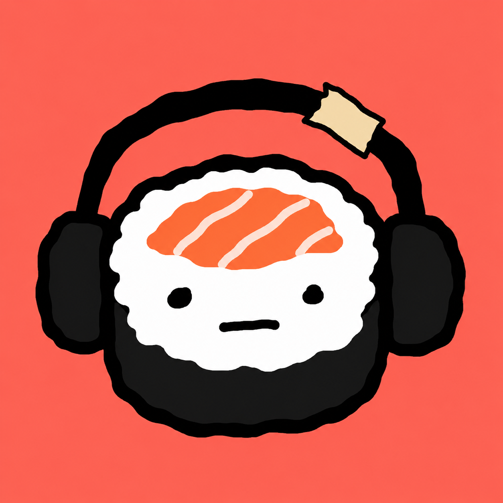

# Maki at Home



When the other group has Maki, there's Maki at Home. This Discord music bot runs on a Windows PC and plays YouTube songs directly into a voice channel. Everyone in the channel hears the same track.

## Install on Windows

Install 64-bit Python 3.12 and Git. Run these commands in PowerShell from the directory where you want to keep the bot.

```powershell
git clone https://github.com/DmitryAnashko/makiathome.git
cd makiathome
py -3.12 -m venv .venv
.\.venv\Scripts\python.exe -m pip install -r requirements.txt
```

The Python packages include FFmpeg, Node.js, and Discord voice encryption support.

## Connect to Discord

1. Create a dedicated application in the [Discord Developer Portal](https://discord.com/developers/applications). Under **Bot**, copy the bot token. For a new application, **Reset Token** reveals a token you can copy.
2. Double-click **Start Bot.cmd**. Paste the token at the hidden prompt and press Enter. The launcher encrypts the saved token for your Windows account on this PC.
3. When the window says **Online as**, open the invite link it prints, select your server, and choose **Authorize**. The person adding the bot needs **Manage Server** permission.
4. Join a voice channel. In a text channel, type `/play`, enter an artist such as `green day`, select a track, and press Enter.

Maki needs **View Channel**, **Connect**, and **Speak** in voice, plus **View Channel** and **Send Messages** where you use commands. The default privileged-intent settings work.

## Commands

| Command | What it does |
| --- | --- |
| `/play` | Queue a YouTube song by artist, song name, or video link. |
| `/queue` | See who requested each track and remove one of your own upcoming songs. |
| `/skip` | Skip the current song, including one that is still loading. |
| `/leave` | Clear this server's queue and disconnect. |
| `/help` | Show a private list of commands and playback controls. |
| `/important` | Post the “Why are you gay?” interview GIF in the current text channel. |

Anyone can use `/help` and `/important` from text chat. Give Maki **Embed Links** permission there to display the GIF inline.

The **Playing** message has **Pause / Resume**, **Skip**, and **Queue** buttons for listeners in Maki's voice channel. Each server has its own queue and one active voice channel. When the last listener leaves, Maki waits two minutes before clearing the queue and disconnecting. Rejoin during those two minutes to keep the session.

YouTube results can include live recordings and covers. For an exact recording, paste its video link. Playback uses yt-dlp, and availability can vary by video or network. Use recordings you have permission to stream.

## Run it again

Double-click **Start Bot.cmd** and leave the window open while listening. Keep the PC awake. Press **Ctrl+C** in that window to stop the bot. Queues reset on shutdown.

For a desktop shortcut, create one for **Start Bot.cmd** and select the included **maki-at-home.ico** under **Properties → Change Icon**. To replace a rotated token, run `& '.\Start Bot.cmd' -ResetToken` in the project folder.

## Run the tests

The tests run locally with a simulated Discord voice connection and require no bot token.

```powershell
.\.venv\Scripts\python.exe -m unittest -v
```
